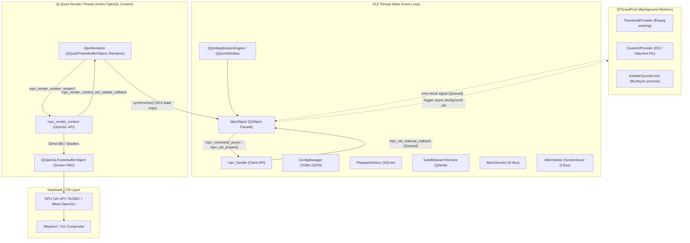

# Parvaz Player — Developer & Architecture Guide

> **Target Audience:** Maintainers, contributors, and AI pair programmers working on the Parvaz codebase.  
> **Prerequisites:** Familiarity with modern C++ (C++20), Qt 6 / QML, OpenGL / RHI fundamentals, and the `libmpv` C client/render API.

---

## ۱. مرور کلی و فلسفه‌ی طراحی (Overview & Core Philosophy)

**پرواز (Parvaz)** یک مدیاپلیر مدرن، سبک و با کارایی بالاست که برای لینوکس (با اولویت دسکتاپ Wayland) طراحی شده است. هدف کلیدی این پروژه ارائه‌ی ارگونومی بی‌نظیر و غنی پلیرهای محبوبی چون **PotPlayer** بر روی لینوکس است، در حالی که هسته‌ی پخش بر پایه‌ی موتور اثبات‌شده و قدرتمند **libmpv** استوار است.

### اصول اساسی معماری:
1. **Zero-Copy Rendering (بدون کپی فریم):** فریم‌های تصویری مستقیماً توسط libmpv بر روی OpenGL Framebuffer Object (FBO) سخت‌افزاری رندر می‌شوند. هیچ داده‌ای با `glReadPixels` یا `QImage` خوانده یا در حافظه کپی نمی‌شود.
2. **مرزبندی دقیق تردها (Strict Thread Boundaries):** فراخوانی‌های مربوط به کنترل هندل mpv فقط و فقط در ترد گرافیکی (GUI Thread) انجام می‌شوند. تمام عملیات رندرینگ و کانتکست OpenGL منحصراً در ترد رندر (Render Thread) صورت می‌گیرند.
3. **تفکیک مسئولیت C++ و QML:** تمام منطق تجاری، محاسبات ریاضی، تعامل با دیتابیس SQLite، شبکه‌بندی REST، خواندن تگ‌های مدیا و کشینگ تصاویر در لایه‌ی C++ پیاده‌سازی شده است. لایه‌ی QML صرفاً وظیفه‌ی چیدمان دکلراتیو، انیمیشن‌ها و تعاملات بصری را بر عهده دارد.
4. **تضمین پایداری از طریق Smoke Tests:** هر فیچر جدید باید دارای تست اتوماتیک باشد و دستور `ninja -C build check` همواره سبز باقی بماند.

---

## ۲. مدل تردها و معماری سیستمی (Threading Model & System Architecture)



### مرزهای فراخوانی توابع libmpv:

| المان | ترد مجاز | توابع و اشیاء مرتبط |
|---|---|---|
| `mpv_handle*` | **فقط GUI Thread** | `mpv_create()`, `mpv_initialize()`, `mpv_command()`, `mpv_set_property()`, `mpv_wait_event()` |
| `mpv_render_context*` | **فقط Render Thread** | `mpv_render_context_create()`, `mpv_render_context_render()`, `mpv_render_context_free()` |
| `QOpenGLContext` | **فقط Render Thread** | کانتکست فعال در حین متدهای `synchronize()` و `render()` در `MpvRenderer` |
| `QThreadPool` | **Worker Threads** | استخراج تصاویر کاور با FFmpeg، ساخت Thumbnailهای Seekbar، پردازش‌های جانبی بدون درگیر کردن GUI |

---

## ۳. ساختار کدهای پروژه (Repository Directory Structure)

```text
parvaz-player/
├── CMakeLists.txt                 # پیکربندی CMake، تشخیص Qt6، libmpv، کتابخانه‌ها
├── AGENTS.md                      # راهنمای تغییرناپذیر قوانین کار و دام‌های حل‌شده
├── ROADMAP.md                     # نقشه راه تفصیلی وضعیت فازهای ۰ تا ۴
├── bench.md                       # لاگ بنچمارک‌های فریم‌ریت، رم و سخت‌افزار
├── tests/                         # دارایی‌های تست اتوماتیک (فایل‌های srt، cp1256)
├── docs/                          # مستندات فنی و راهنمای توسعه‌دهندگان
│   └── DEVELOPER_GUIDE.md         # همین مستند
├── src/                           # هسته‌ی بک‌اند به زبان C++20
│   ├── main.cpp                   # تابع main، تنظیم گرافیک RHI، کامندهای CLI و تست اسموک
│   ├── config/
│   │   ├── ConfigManager.h/.cpp   # مدیریت تنظیمات دیسک (JSON/TOML)، کلیدها، فیلترها
│   ├── mpv/
│   │   ├── MpvObject.h/.cpp       # شیء اصلی ارتباطی با QML و هندلر رویدادهای mpv
│   │   ├── MpvFboItem.h/.cpp      # آیتم واسط QQuickFramebufferObject در صحنه QML
│   │   ├── MpvRenderer.h/.cpp     # رندرر داخلی در Render Thread با کانتکست OpenGL
│   │   └── SubtitleController.h/.cpp # مدیریت ترک‌ها، تاخیر، کدپیج و موقعیت زیرنویس
│   ├── platform/
│   │   ├── IdleInhibitor.h/.cpp   # جلوگیری از خاموش شدن صفحه هنگام پخش (D-Bus)
│   │   └── MprisService.h/.cpp    # یکپارچگی کامل با مدیاکیبورد و D-Bus MPRIS v2
│   ├── playback/
│   │   ├── PlaybackHistory.h/.cpp # ذخیره‌سازی وضعیت فایل‌ها و بوکمارک‌ها در SQLite
│   │   ├── ThumbnailProvider.h/.cpp # تولید ناهمگام پیش‌نمایش تامبنیل seekbar
│   │   ├── CoverArtProvider.h/.cpp  # استخراج تصویر کاور آلبوم موزیک با کش دیسک
│   │   ├── ShaderManager.h/.cpp   # مدیریت شیدرهای FSR، Deband و Anime4K
│   │   ├── ScreenshotController.h/.cpp # ضبط اسکرین‌شات تمیز از فریم در حال پخش
│   │   └── CacheMaintenance.h/.cpp # پاکسازی دوره‌ای کش‌های موقت
│   └── subs/
│       ├── SubtitleSearchService.h/.cpp # جستجوی آنلاین، هش فیلم، دانلود و ذخیره ایمن
│       └── SubtitleSyncService.h/.cpp   # همگام‌سازی هوشمند زیرنویس با صدا (ffsubsync)
└── qml/                           # رابط کاربری دکلراتیو Qt Quick
    ├── Main.qml                   # پنجره اصلی، مدیریت فوکوس، شورت‌کات‌ها و چیدمان
    ├── components/                # کامپوننت‌های ماژولار و سفارشی UI
    │   ├── ControlBar.qml         # نوار ابزار پایین با طراحی شناور/داک و دکمه‌های کنترلی
    │   ├── ControlCenter.qml      # مرکز تنظیمات حرفه‌ای تصویر، اکولایزر، شیدر (F7)
    │   ├── ContextMenu.qml        # منوی کلیک‌راست غنی و کامل با استایل PotPlayer
    │   ├── MusicPlayerView.qml    # رابط اختصاصی پخش موزیک با اکولایزر ۳۲ باندی و کاور
    │   ├── PlaylistDrawer.qml     # دراور کشویی پلی‌لیست با فیلتر سریع و Drag & Drop (F6)
    │   ├── SubtitleSearchDialog.qml # دیالوگ سرچ زیرنویس آنلاین با وضعیت اعمال زنده
    │   ├── OpenUrlDialog.qml      # دیالوگ پخش استریم و URL شبکه با تاریخچه‌ی اخیر (Ctrl+U)
    │   ├── TechnicalInfoOverlay.qml # پنل اطلاعات فنی نرخ فریم، کدک و کش (Tab)
    │   ├── DropOverlay.qml        # ناحیه Drop دوگانه (Play Now vs Play Later)
    │   ├── OsdOverlay.qml         # اعلان‌های OSD لبه بالا به سبک PotPlayer
    │   ├── NextEpisodePrompt.qml  # تشخیص تیتراژ پایانی و دکمه پرش به قسمت بعد
    │   ├── LoadingSpinner.qml     # انیمیشن انتظار هنگام بافر استریم شبکه
    │   ├── SeekBar.qml            # نوار پیشرفت پخش با تامبنیل شناور روی ماوس
    │   └── Theme.qml              # متغیرهای رنگی، فونت‌ها و فواصل تم برنامه
    ├── fonts/                     # فونت‌های باندل‌شده درون‌برنامه‌ای
    │   ├── Vazirmatn.ttf          # فونت وزیرمتن برای متن زیرنویس‌های فارسی/عربی
    │   ├── JetBrainsMono-Regular.otf
    │   └── JetBrainsMono-Medium.otf
    └── icons/                     # آیکون‌های وکتور مدرن SVG
```

---

## ۴. زیرسیستم‌های کلیدی (Key Subsystems Deep-Dive)

### ۴.۱. رندرینگ Zero-Copy با `MpvFboItem` و `MpvRenderer`

در Qt Quick 6، برای رندر مستقیم OpenGL با حداکثر بهره‌وری، از کلاس `QQuickFramebufferObject` استفاده می‌شود:
- `MpvFboItem` به عنوان یک `QQuickItem` در صحنه‌ی QML قرار می‌گیرد و اندازه‌ها و سیگنال‌های رابط کاربری را دریافت می‌کند.
- `MpvRenderer` نمونه‌ی ساب‌کلاس `QQuickFramebufferObject::Renderer` است که متدهای آن منحصراً در **Render Thread** اجرا می‌شوند.

```cpp
// در متد synchronize(): داده‌های سبک بدون نیاز به قفل کپی می‌شوند
void MpvRenderer::synchronize(QQuickFramebufferObject *item)
{
    if (!m_mpvGL && m_item->mpvObject()) {
        // ایجاد mpv_render_context با کانتکست فعال OpenGL
        mpv_opengl_init_params glParams{getProcAddress, nullptr};
        mpv_render_param params[] = {
            {MPV_RENDER_PARAM_API_TYPE, const_cast<char*>(MPV_RENDER_API_TYPE_OPENGL)},
            {MPV_RENDER_PARAM_OPENGL_INIT_PARAMS, &glParams},
            {MPV_RENDER_PARAM_INVALID, nullptr}
        };
        mpv_render_context_create(&m_mpvGL, m_item->mpvObject()->mpvHandle(), params);
        mpv_render_context_set_update_callback(m_mpvGL, onMpvUpdate, this);
    }
}

// در متد render(): رندر مستقیم فریم ویدیو در FBO جاری بدون هیچگونه کپی حافظه
void MpvRenderer::render()
{
    QOpenGLFramebufferObject *fbo = framebufferObject();
    mpv_opengl_fbo mpvFbo{
        .fbo = static_cast<int>(fbo->handle()),
        .w = fbo->width(),
        .h = fbo->height(),
        .internal_format = 0
    };
    int flipY = 0; // در Qt FBO مبدا مختصات نیازی به اینورت ندارد
    mpv_render_param params[] = {
        {MPV_RENDER_PARAM_OPENGL_FBO, &mpvFbo},
        {MPV_RENDER_PARAM_FLIP_Y, &flipY},
        {MPV_RENDER_PARAM_INVALID, nullptr}
    };
    mpv_render_context_render(m_mpvGL, params);
}
```

### ۴.۲. خط لوله‌ی زیرنویس فارسی و بین‌المللی (Subtitle Pipeline)

1. **مدیریت فونت و رندر متنی:**
   - برای زیرنویس‌های بدون استایل صریح (مثل SRT)، گزینه‌ی `sub-font="Vazirmatn"` تنظیم شده است.
   - فایل فونت `Vazirmatn.ttf` در هنگام لود برنامه از منابع درون‌برنامه‌ای به مسیر کش دیسک (`~/.cache/Parvaz/Parvaz/fonts/`) کپی شده و با گزینه‌ی `sub-fonts-dir` به موتور `libass` معرفی می‌شود.
   - گزینه‌ی `sub-ass-override="scale"` فعال است تا زیرنویس‌های تخصصی ASS (مانند انیمه‌ها با فونت‌ها و استایل‌های گرافیکی خاص) هویت طراحی‌شده‌ی خود را حفظ کنند و خراب نشوند.
2. **پشتیبانی از اینکودینگ قدیمی ویندوز:**
   - امکان سوئیچ لحظه‌ای بین UTF-8 و `cp1256` (Windows Arabic/Persian) بدون نیاز به ریست پلیر از طریق `SubtitleController`.
3. **موتور جستجوی آنلاین زیرنویس (`SubtitleSearchService`):**
   - اتصال تجمیعی همزمان به APIهای **OpenSubtitles v3**، **Stremio Catalogs** و میرور اختصاصی **SubSource**.
   - محاسبه‌ی هش دقیق باینری فایل ویدیویی (`computeOpenSubtitlesHash`) بر پایه‌ی الگوریتم اختصاصی OpenSubtitles برای یافتن نسخه‌ی کاملاً هماهنگ.
   - فیلتر کردن هوشمند زبان‌ها (FA، EN، All).
   - **ذخیره‌سازی ایمن روی دیسک:** به دلیل محدودیت فایل‌سیستم‌های لینوکس/ویندوز (`NAME_MAX = 255 bytes`)، نام فایل‌های دانلودشده به حداکثر ۶۰ کاراکتر تمیز به همراه شناسه‌ی یکتا کوتاه شده و در مسیر کش ذخیره می‌شوند تا از خطای `ENAMETOOLONG` جلوگیری شود. همچنین فایل‌های فشرده (Zip) در پوشه‌ای ایزوله استخراج می‌شوند.
4. **همگام‌سازی اتوماتیک با صدا (`SubtitleSyncService`):**
   - ادغام با ابزار پیشرفته‌ی `ffsubsync` به صورت پس‌زمینه؛ استخراج پروفایل صوتی فیلم و همگام‌سازی میلی‌ثانیه‌ای تایم‌لاین زیرنویس با فرکانس گفتار.

### ۴.۳. لایه‌ی بهینه‌سازی تصویر و شیدرها (Video Enhancements & Shaders)

- **AMD FidelityFX Super Resolution (FSR):** آپ‌اسکیل هوشمند با حفظ وضوح لبه‌ها از طریق شیدرهای GLSL.
- **Debanding Filter:** فیلتر حذف آرتیفکت‌های پله‌پله‌شدن رنگ‌ها (Color Banding) با تنظیم داینامیک تکرار (`iterations`)، آستانه (`threshold`) و محدوده (`range`).
- **HDR Tone Mapping:** تنظیم داینامیک تن‌مپینگ برای مانیتورهای SDR با الگوریتم‌های استاندارد هالیوودی نظیر `bt.2446a`، `spline` و محاسبه‌ی پیک لحظه‌ای `hdr-compute-peak`.

### ۴.۴. حالت اختصاصی پخش موزیک و ویژوالایزر (Music Player Mode & Visualizer)

هنگامی که فایل صوتی لود می‌شود (`Mpv.isAudioOnly == true`):
1. ویدیو پنهان شده و رابط کاربری `MusicPlayerView` فعال می‌شود.
2. تصویر کاور آلبوم استخراج شده و به عنوان پس‌زمینه‌ی آمبینت بلورشده با تم تیره نمایش می‌یابد.
3. در صورت نبود کاور، انیمیشن چرخشی صفحه گرامافون (Vinyl) فعال می‌شود.
4. **اکولایزر ویژوالایزر ۳۲ باندی:**
   - فرکانس‌های صوتی در ۳۲ باند مجزا (از فرکانس‌های بم ۲۰ هرتز تا فرکانس‌های تریبل ۲۰ کیلوهرتز) توزیع شده‌اند.
   - از فیلتر نرمالایز لاگاریتمی برای نمایش ریتمیک و زنده‌ی افت و خیزهای موسیقی استفاده می‌شود.
   - رنگ میله‌های اکولایزر بر اساس پالت رنگی انتخاب‌شده در تم برنامه (`Theme.accentGradient`) داینامیک است.

---

## ۵. راهنمای رابط کاربری و فوکوس کیبورد (QML & Input Focus Architecture)

### مدیریت فوکوس و کیبورد در `Main.qml`:
در Qt Quick، شیء ریشه‌ی پنجره (`Window`) از نوع `Item` نیست و متد `forceActiveFocus()` ندارد. فراخوانی آن بر روی پنجره منجر به خطای کشنده‌ی جاوااسکریپت (`TypeError`) می‌شود.  
به همین دلیل، معماری فوکوس در پرواز به شکل زیر تضمین شده است:
1. `videoMouseArea` به عنوان یک `Item` معتبر در تمام صفحه قرار دارد و ویژگی `focus: true` دارد.
2. تابع ریشه‌ای `restorePlayerFocus()` پیاده‌سازی شده است:
   ```qml
   function restorePlayerFocus() {
       root.requestActivate();
       videoMouseArea.forceActiveFocus();
   }
   ```
3. تمامی دیالوگ‌ها (سرچ زیرنویس، انتخاب فایل، URL، مرکز کنترل و کشوی پلی‌لیست) در هنگام بسته شدن سیگنال `closed` داده و `restorePlayerFocus()` را صدا می‌زنند.
4. میانبرهای سراسری از کامپوننت `PlayerShortcut` که ارث‌بری‌شده از `Shortcut` با ویژگی `context: Qt.ApplicationShortcut` است استفاده می‌کنند تا بدون توجه به آیتم تحت فوکوس، کلیدهای میانبر استاندارد عمل کنند.

---

## ۶. جدول کلیدهای میانبر استاندارد (PotPlayer Shortcuts Reference)

| کلید | عملکرد | توضیحات فنی |
|---|---|---|
| <kbd>Space</kbd> | پخش / توقف (Play/Pause) | فراخوانی `Mpv.togglePause()` |
| <kbd>→</kbd> / <kbd>←</kbd> | پرش ۵ ثانیه‌ای به جلو / عقب | `Mpv.seekRelative(±5)` |
| <kbd>Ctrl</kbd> + <kbd>→</kbd> / <kbd>←</kbd> | پرش ۳۰ ثانیه‌ای به جلو / عقب | `Mpv.seekRelative(±30)` |
| <kbd>Shift</kbd> + <kbd>→</kbd> / <kbd>←</kbd> | پرش ۶۰ ثانیه‌ای به جلو / عقب | `Mpv.seekRelative(±60)` |
| <kbd>Ctrl</kbd> + <kbd>Shift</kbd> + <kbd>→</kbd> / <kbd>←</kbd> | پرش ۵ دقیقه‌ای (۳۰۰ ثانیه) | `Mpv.seekRelative(±300)` |
| <kbd>Backspace</kbd> / <kbd>Home</kbd> | بازگشت به ابتدای فایل (00:00:00) | `Mpv.seekAbsolute(0)` |
| <kbd>Z</kbd> | بازنشانی سرعت پخش به 1.0x | `Mpv.resetSpeed()` |
| <kbd>C</kbd> / <kbd>X</kbd> | افزایش / کاهش سرعت به میزان 0.1x | `Mpv.adjustSpeed(±0.1)` |
| <kbd>↑</kbd> / <kbd>↓</kbd> | افزایش / کاهش صدا (۵٪) | با قابلیت بوست صدا تا ۱۵۰٪ |
| <kbd>M</kbd> | قطع / وصل صدا (Mute) | `Mpv.setMuted()` |
| <kbd>F</kbd> / <kbd>Enter</kbd> | تمام‌صفحه (Toggle Fullscreen) | پشتیبانی کامل از دسکتاپ‌های Wayland |
| <kbd>1</kbd>, <kbd>2</kbd>, <kbd>3</kbd>, <kbd>4</kbd> | تغییر اندازه پنجره به مضارب استاندارد | 0.5x (360p), 1.0x (720p), 1.5x (900p), 2.0x (1080p) |
| <kbd>Tab</kbd> | نمایش پنل اطلاعات فنی (OSD) | رزولوشن، کدک، فریم‌ریت، دراپ فریم و مصرف بافر |
| <kbd>F6</kbd> | باز / بسته کردن کشوی پلی‌لیست | اسلاید نرم از راست با قابلیت جستجو |
| <kbd>F7</kbd> | باز / بسته کردن شناور مرکز کنترل | تنظیمات بلادرنگ رنگ تصویر، شیدر و اکولایزر |
| <kbd>Ctrl</kbd> + <kbd>Shift</kbd> + <kbd>S</kbd> | جستجوی آنلاین زیرنویس | سرچ مولتی‌پروایدر با تطابق هش |
| <kbd>Ctrl</kbd> + <kbd>U</kbd> | باز کردن لینک یا استریم آنلاین | سازگار با یوتیوب، HLS/m3u8 و مگنت |
| <kbd>,</kbd> / <kbd>.</kbd> | حرکت فریم‌به‌فریم به عقب / جلو | `Mpv.frameStep(±1)` |
| <kbd>Esc</kbd> | بستن دیالوگ باز / خروج از تمام‌صفحه | بازیابی اتوماتیک فوکوس فعال |

---

## ۷. بیلد، تست و محیط توسعه (Build, Smoke Tests & Debugging)

### پیش‌نیازها بر روی توزیع‌های مبتنی بر ردهت / فدورا (Fedora / RHEL):
```bash
sudo dnf install gcc-c++ cmake ninja-build mpv-libs-devel \
  qt6-qtbase-devel qt6-qtdeclarative-devel qt6-qtquickcontrols2-devel \
  mesa-libGL-devel libplacebo-devel sqlite-devel \
  mesa-va-drivers-freeworld libva-utils
```

### کامپایل پروژه:
```bash
cmake -B build -G Ninja -DCMAKE_BUILD_TYPE=RelWithDebInfo
ninja -C build
```

### اجرای تست‌های جامع و اعتبارسنجی (Smoke Test Suite):
پرواز دارای یک تارگت اتوماتیک به نام `check` است که یک فایل ویدیویی تست و یک ترک صوتی تولید کرده و بیش از ۵۰ ویژگی کلیدی (فریم‌ریت، پارسینگ زیرنویس، اینکودینگ CP1256، اکولایزر، تغییر سرعت، شیدرها، بوکمارک و...) را در یک اجرای واقعی بررسی می‌کند:
```bash
ninja -C build check
```
> **قانون سخت‌گیرانه:** بر اساس Rule 6 در `AGENTS.md`، دستور `ninja -C build check` باید قبل از هر کامیت سبز باشد.

### بنچمارک عملکرد واقعی:
```bash
./build/parvaz --bench 8 path/to/sample_1080p60.mkv
```
خروجی بنچمارک شامل تعداد فریم‌های رندرشده، زمان دقیق موقعیت، حافظه‌ی مصرفی Resident Set Size (RSS) و وضعیت فعال بودن دیکود سخت‌افزاری (`hwdec`) خواهد بود.

### نکات حیاتی دیباگ لاگ‌ها (Debugging Rule 8):
در بیلد فدورا، پکیج‌های پیش‌فرض Qt با فلگ `QT_NO_DEBUG_OUTPUT` کامپایل شده‌اند؛ به همین دلیل توابع `qDebug()`، `qInfo()` و `console.log()` در کنسول ساکت می‌مانند.  
**قاعده:** برای لاگ‌های دیباگ در C++ همیشه از `std::fprintf(stderr, ...)` استفاده کنید.

متغیرهای محیطی مفید برای خطایابی:
- **مشکلات Wayland:** `WAYLAND_DEBUG=1 ./build/parvaz file.mkv`
- **مشکلات درایور Mesa و OpenGL:** `MESA_DEBUG=1 ./build/parvaz file.mkv`
- **اطلاعات صحنه گرافیکی Qt Quick:** `QSG_INFO=1 QT_LOGGING_RULES="qt.quick.*=true" ./build/parvaz file.mkv`
- **لاگ‌های پرحجم داخلی mpv:** افزودن `mpv_set_option_string(m_mpv, "msg-level", "all=v")` در کد.
